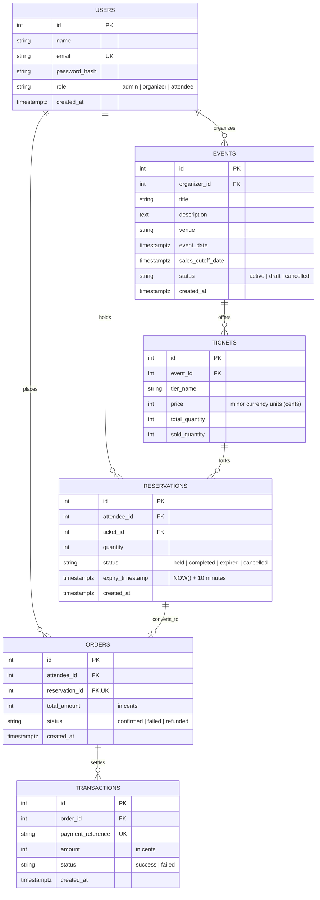

# Multi-Tenant Event & Ticket Reservation System MVP

A high-concurrency, multi-tenant Event and Ticket Reservation platform engineered with **Node.js, Express, PostgreSQL, Upstash Redis**, and **React 18 (Vite + Tailwind CSS + Recharts)**.

---

## 1. System Architecture & Entity-Relationship (ER) Diagram

The system employs a multi-tenant relational schema enforced with strict foreign keys, cascade constraints, check constraints, and performance indexes.



---

## 2. Core Features & Concurrency Guarantees

### A. 10-Minute Atomic Ticket Holds & Concurrency Protection
* **PostgreSQL Row-Level Locking:** When an attendee requests a hold, the ticket tier is locked using `SELECT ... FOR UPDATE OF t`.
* **Atomic Availability Calculation:** Available tickets are computed within the open transaction as:
  $$\text{Available} = \text{Total Capacity} - \text{Sold Quantity} - \text{Active Unexpired Holds}$$
* **No Overselling:** If two concurrent requests compete for the final ticket, PostgreSQL forces serial execution; one receives the hold while the second receives an explicit `400 Insufficient tickets available` error.
* **Sales Cutoff Protection:** Reservations are rejected immediately if the event's `sales_cutoff_date` has elapsed.

### B. Background Expiration Worker
* A scheduled background worker checks every 60 seconds for holds where `status = 'held' AND expiry_timestamp <= NOW()`.
* Uses `FOR UPDATE SKIP LOCKED` to allow overlapping worker executions without blocking or deadlocks.
* Safely releases each hold exactly once, transitions status to `expired`, and clears the Upstash Redis cache. Completed orders (`status = 'completed'`) are never touched.

### C. Mock Asynchronous Payment Gateway & Idempotency
* Endpoint: `POST /api/payments/mock`
* Simulates gateway network latency (350ms delay).
* **Payment Approval Flow:** On approval, transitions hold to `completed`, increments `sold_quantity` permanently, creates a `confirmed` order, and records a `success` transaction.
* **Payment Decline Flow:** On rejection, marks hold `cancelled` (instantly returning held seats to inventory), records a `failed` order and `failed` transaction.
* **Idempotency Guarantee:** If a payment request with an identical reservation is repeated, the server returns the existing confirmed order without charging or booking twice.
* **Expired Hold Rejection:** Payments attempted on expired reservations are rejected with an explicit error.

### D. Upstash Redis Caching & Local Fallback
* Active event details and tier availability are cached in Upstash Redis with a 120-second TTL.
* Cache invalidation is automatically triggered on hold creation, payment confirmation, hold cancellation, admin status updates, or background worker expirations.
* **Zero-Setup Fallback:** If Upstash Redis credentials (`UPSTASH_REDIS_REST_URL`) are omitted, an in-memory Redis-compliant fallback is used automatically for seamless local development.

### E. Multi-Tenant Role-Based Access Control (RBAC)
* **Admin:** System-wide visibility over all users, events, and bookings. Ability to activate or cancel events.
* **Organizer:** Scoped exclusively to their own events. Create and edit events, configure ticket tiers, and view real-time sales analytics and conversion rates.
* **Attendee:** Browse events, hold tickets, checkout with mock payment, and view booking history.

---

## 3. Seeded Demo Accounts (1-Click Instant Login)

The system comes pre-seeded with accounts for all three roles:

| Role | Email | Password | Permissions |
| :--- | :--- | :--- | :--- |
| **Admin** | `admin@tickets.com` | `admin123` | Platform-wide analytics, manage all events and users |
| **Organizer 1** | `organizer@soundwave.com` | `organizer123` | SoundWave Productions events & analytics |
| **Organizer 2** | `marcus@futuretech.io` | `organizer123` | FutureTech Events & analytics |
| **Attendee 1** | `attendee@example.com` | `attendee123` | General attendee booking & checkout |
| **Attendee 2** | `alice@example.com` | `attendee123` | Concurrency test attendee |

> **Tip:** The web frontend features a top **MVP Quick Switcher** banner and instant 1-click login buttons in the login modal.

---

## 4. Local Installation & Setup

### Prerequisites
* **Node.js** (v18.0.0 or higher)
* **PostgreSQL** (Local instance or Supabase/Neon PostgreSQL URI)

### Step 1: Clone and Configure Environment Variables
Copy the example environment configuration into `server/.env`:

```bash
cp .env.example server/.env
```

Review `server/.env`:
```env
PORT=5000
NODE_ENV=development
DATABASE_URL=postgres://postgres@localhost:5432/event_reservation
JWT_SECRET=super_secret_jwt_key_event_reservation_system_2026
UPSTASH_REDIS_REST_URL=
UPSTASH_REDIS_REST_TOKEN=
RESERVATION_EXPIRY_MINUTES=10
```
*(Leave `UPSTASH_REDIS_REST_URL` empty to use the automatic local in-memory Redis fallback cache).*

### Step 2: Install Dependencies
```bash
# Install server dependencies
cd server
npm install

# Install client dependencies
cd ../client
npm install
cd ..
```

### Step 3: Run Migrations and Seed Database
```bash
# Migrate database schema
npm run migrate

# Seed demo users, events, and ticket tiers
npm run seed
```

### Step 4: Start Server and Client
In separate terminal windows:

```bash
# Terminal 1: Start Backend API (Port 5000 + Expiry Worker)
npm run server:dev

# Terminal 2: Start Frontend Web App (Port 3000)
npm run client
```

Open your browser at **`http://localhost:3000`**.

---

## 5. Automated Integration Test Suite

The test suite validates all required concurrency, payment, and edge-case behaviors:

```bash
npm test
```

### Covered Test Cases:
1. **Authentication:** JWT issuance and role verification for Admin, Organizer, and Attendee.
2. **Successful Reservation & Payment:** 10-minute hold creation, live inventory decrement, and order confirmation.
3. **Rejected Payment:** Asynchronous payment failure simulation releasing held inventory back to the pool.
4. **Expired Reservation Rejection:** Checkout attempts on expired holds are rejected.
5. **Concurrency Test:** Two simultaneous booking requests for the final remaining ticket — exactly one succeeds while the other is rejected without overselling.
6. **Role Restrictions:** Organizers cannot alter other organizers' events; attendees cannot access admin analytics.
7. **Payment Idempotency:** Duplicate payment requests return the existing confirmed order without double-charging.
8. **Sales Cutoff Date Validation:** Rejection of reservations on events where sales cutoff has passed.

---

## 6. Postman API Collection

An importable Postman collection is included in:
[`postman/Event_Reservation_System.postman_collection.json`](file:///c:/Users/r3182/OneDrive/Desktop/web_technology/postman/Event_Reservation_System.postman_collection.json)

### Importing to Postman:
1. Open Postman -> Click **Import** -> Select `postman/Event_Reservation_System.postman_collection.json`.
2. The collection contains pre-configured test scripts that automatically capture JWT tokens for `attendeeToken`, `organizerToken`, and `adminToken`.
3. Run the requests sequentially to test the full lifecycle:
   * **Authentication:** Register & Login
   * **Events:** List events, View event with tiers, Create event, Update event
   * **Reservations:** Create 10-min hold, View hold, Cancel hold
   * **Mock Payments:** Approve simulation, Decline simulation, Duplicate idempotent call
   * **Organizer:** Analytics & Revenue breakdown
   * **Admin:** Platform summary & Status updates

---

## 7. Deployment Instructions

### Deploy Backend (Render, Railway, or Fly.io)
1. Set Environment variables in your hosting provider:
   - `DATABASE_URL`: Connection string from Supabase or Neon.
   - `JWT_SECRET`: Random secure string.
   - `UPSTASH_REDIS_REST_URL` & `UPSTASH_REDIS_REST_TOKEN`: From your Upstash console.
   - `NODE_ENV`: `production`
2. Build & Start command: `node src/index.js`

### Deploy Frontend (Vercel or Netlify)
1. Root directory: `client`
2. Build command: `npm run build`
3. Output directory: `dist`
4. Set proxy or environment variable `VITE_API_BASE_URL` pointing to the deployed backend URL.
